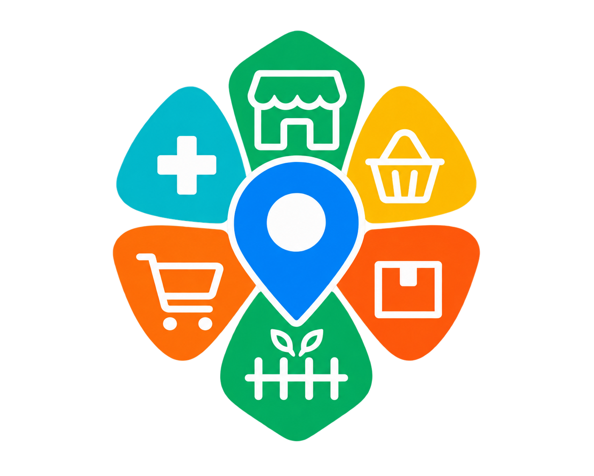

  

# Mi Tiendita Cercana

**Todo a un paso de ti.**

Mi Tiendita Cercana es una plataforma tecnológica en desarrollo que busca conectar a los clientes con pequeños y medianos comercios, facilitando el acceso a sus productos desde un entorno digital.

## ¿Qué queremos lograr?

Ayudar a los pequeños y medianos comercios a fortalecer su presencia digital, acercarse a nuevos clientes y gestionar sus productos mediante herramientas tecnológicas accesibles.

## ¿Qué hace diferente a Mi Tiendita Cercana?

Mi Tiendita Cercana busca acercar la tecnología a los pequeños y medianos comercios, ayudándolos a tener presencia digital y conectarse con clientes de su entorno.
- **Cercanía: facilita el descubrimiento de comercios próximos.**
- **Autonomía: cada comerciante administra los precios de su propia tienda.**
- **Digitalización: permite mostrar catálogos y recibir pedidos mediante una plataforma digital.**
- **Oportunidad de crecimiento: busca abrir nuevas posibilidades para que los comercios fortalezcan su presencia en el mercado.**

## Funcionalidades de la plataforma

- **Comercios cercanos:** facilitar que los clientes encuentren tiendas próximas a su ubicación.
- **Catálogos digitales:** consultar los productos de cada comercio.
- **Precios independientes:** cada comerciante puede administrar los precios de su propia tienda.
- **Pedidos digitales:** seleccionar productos y enviar solicitudes al comercio.
- **Panel del comerciante:** gestionar productos y atender pedidos.
- **Diseño adaptable:** orientado a móviles, tabletas y computadores.

## Tecnologías utilizadas

- JavaScript
- HTML y CSS
- Firebase Authentication
- Cloud Firestore
- Firebase Hosting
- Cloud Functions for Firebase

## Modelo de negocio

La propuesta contempla un modelo de monetización basado en un cobro por servicio u operación completada. Las condiciones comerciales se validarán durante las pruebas piloto.

## Estado del proyecto

Mi Tiendita Cercana se encuentra en desarrollo y preparación para pruebas con comerciantes y clientes. El objetivo es validar su funcionamiento, mejorar la experiencia de uso y construir una solución que responda a necesidades reales.

## Conoce la plataforma

**Sitio web:** https://mi-tiendita-cercana.web.app

**Repositorio del proyecto:** https://github.com/ramiro1424/mi-tiendita-cercana

---

*Mi Tiendita Cercana — Todo a un paso de ti.*
